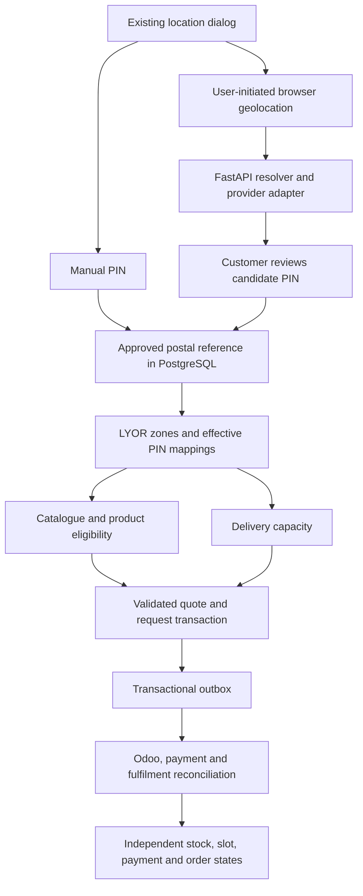

# Location and delivery serviceability: high-level design

LOC-00 design, accepted 2026-11-27. The table below preserves the pre-feature audit. LOC-01 now adds offline postal/zone configuration, manual FastAPI checks and an opt-in dialog; later phases remain proposed. Acceptance and execution evidence live in the [LOC plan](../implementation/location-serviceability-plan.md). This workstream has separate gates from backend migration Phase 05.

## Audited behavior

| Concern | Current repository evidence | Capability gap |
| --- | --- | --- |
| Location UI | `apps/web/src/components/header.tsx` owns a Radix dialog, numeric input, request cancellation and feedback. `delivery-location-button.tsx` opens its trigger | City is fixed to Noida; no current-location action, detected-PIN confirmation or dedicated unknown-PIN result |
| Persistence | `store-provider.tsx` persists `lyor-pin-v1`, retains carts, clears quotes on PIN change and rejects stale quote responses | No structured location preference, cross-tab PIN synchronization or server-visible selected location for catalogue rendering |
| Manual check | `app/api/v1/catalog.py` exposes `GET /serviceability?pin=...`; `common.py` contains nine synthetic Noida PINs | Format check only; no postal reference, administrative boundaries, configured zones or effective dates |
| Catalogue | `catalog.py` filters published, active demo-company products by `Product.cities`; browser routes and DTOs support Noida only | PIN does not affect product selection; stock is a synthetic scalar, not warehouse/date-aware Odoo availability |
| Quote | `pricing.py` validates demo coverage, product eligibility and demand; signs a 15-minute owner/cart/revision/PIN-bound quote | No serviceability revision, slot context or live inventory source |
| Checkout | `orders.py` validates ownership, expiry, signature, address PIN, cart revision and price under SERIALIZABLE isolation; writes intent, outbox and audit together | Address has name, phone, street and PIN only. No slot, payment verification or authoritative upstream reservation |
| Worker | `workers/process.py` atomically decrements mock stock and writes reservations, audit and outbox completion | `confirmed_demo` is synthetic; no live booking guarantee. Preserve independent payment and delivery states |
| Staff | `staff.py` and `/admin` provide publication and guarded recovery using customer/catalog/admin roles | No zone, PIN, capacity or expansion-interest management |
| Data | Eight mapped business tables plus the immutable Alembic baseline | No City, PostalCode, DeliveryZone or DeliveryCapacity entity exists to reuse |
| Runtime | FastAPI settings currently permit development/test demo mode only. Next.js proxy defaults to legacy port 4000 | Live identity and production settings remain migration/release dependencies |
| Infrastructure | Redis brokers Celery; `LegacyHttpLimits` limits per process. SQLAlchemy engine supplies pooling | No distributed provider quota limiter, geocoding circuit breaker or location telemetry |
| Release | `infra/Dockerfile.api` packages the legacy Node demo; `compose.yaml` supplies local PostgreSQL/Redis; CI runs legacy checks | FastAPI/worker Cloud Run artifacts, Secret Manager bindings and staging telemetry are still migration Phase 06 work |

The existing tests cover unsupported demo PINs, signed quotes, cart persistence, tenure, identity and request receipts. `122002`, `110024` and a named `DEMO-001` scenario are absent from the inspected application and test sources; introduce explicit synthetic fixtures without representing them as verified live coverage. `400001` already appears in differential tests as outside the Noida demo.

## Approved coverage and authority

The user confirmed on 2026-11-27 that LYOR covers all valid PIN codes in Delhi's entire NCT and Gurugram city (Gurgaon). The postal dataset/provider and verified PIN list are pending. This supersedes a narrower interpretation of New Delhi in the initial request. Gurugram district is not interchangeable with Gurugram city. Generate a versioned coverage manifest after approving the source and administrative mapping; never infer coverage from `110`/`122` prefixes, a city-name substring, or a successful geocode. Ambiguous boundary PINs require evidence before activation.

Postal reference establishes whether a PIN exists and its geographic metadata. LYOR PostgreSQL configuration establishes delivery eligibility and operational pauses. Capacity establishes whether a particular window can accept a request. Odoo establishes authoritative stock/reservations; Atlas owns fulfilment; PMS owns property references. Verified payment and all required confirmations establish a booking. Each decision remains separate.

## Application boundaries and compatibility

Keep one modular FastAPI application, with API and Celery processes separate. Extract domain services reusable by routes, quoting, request validation and workers. Next.js remains a presentation layer and same-origin proxy; no new Node backend is needed. Preserve the existing header, Radix focus handling, carousel, wishlist, product variants, tenure URLs and recoverable carts.

Retain the original 18-operation demo contract and rollback runtime. New serviceability endpoints and versioned delivery request/quote operations are FastAPI-only. Select the location feature with explicit server configuration and verified backend capabilities, never by silently falling back from a failed live request to demo success. Existing demo requests stay demo requests. A legacy rollback disables new delivery writes and preserves their records for reconciliation; legacy workers must not consume new events.

Production startup, real identity, verified Odoo availability/payment contracts and cloud deployment are dependencies, not capabilities granted by LOC-00. Live enablement must remain off until those dependencies and the LOC gate pass. An isolated display-only Odoo preview can remain Noida-specific without extending January live coverage to Noida.

## UI and design evidence

Reuse the [storefront design system](storefront-design-system.md), paper surfaces, terracotta actions, olive feedback, local Inter/Lora fonts and existing responsive dialog. The Figma checkout/account frame `17:20` was read through the Figma MCP screenshot on 2026-11-27: it shows address/PIN, preferred date/window, availability after address confirmation and a separate rental summary. These are reference layout elements, not existing backend capabilities. No Figma file was changed.

The dialog adds manual check, current-location action, detected-PIN confirmation, retry and consented Notify Me. Keep manual entry enabled when provider/GPS fails. Announce loading and results, return focus on close, support Escape and keyboard controls, and test 1440 px desktop, 768 px tablet and 390 px mobile. Do not prompt for GPS on load or continuously track coordinates.

## Dependencies and rollout

See the [low-level contracts](location-serviceability-lld.md), [database design](serviceability-database.md), [provider design](geocoding-provider-design.md) and [phase plan](../implementation/location-serviceability-plan.md). LOC-00 changes documentation only. Each later phase requires its own evidence and user acceptance; production migrations, configuration changes, worker cutover and deployment retain separate approvals.
