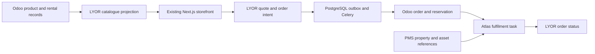

# Rental and integration architecture

| System | Owned state |
| --- | --- |
| Odoo | Approved rental rates, commercial documents, reservations, stock moves and accounting |
| LYOR | Listing projections, carts, quote snapshots, order intent and transactional outbox |
| Atlas | Delivery, installation, pickup, inspection tasks and work evidence |
| PMS | Property, site, room and asset assignment references for applicable orders |

Record the Odoo rental period, currency, applicable template or variant, pricelist and version or effective date. Compare existing LYOR quotes with a staging Odoo quote for each supported tenure. Finance approves the treatment of deposits, delivery, taxes and rounding.

Read catalogue and pricing through JSON-2 with a company-scoped service account. Commercial writes need independently approved permissions and a verified Odoo action. The LYOR transactional outbox carries the order reference. Record the confirmed Odoo reference and reconcile uncertain responses before retrying. Odoo performs the final reservation through the verified commercial contract.

Give each adapter its own test credentials and evidence. The Atlas employee webhook is a separate workflow from rental delivery and return tasks.

[Odoo JSON-2 API](https://www.odoo.com/documentation/19.0/developer/reference/external_api.html) · [Odoo rental pricing and transfers](https://www.odoo.com/documentation/19.0/applications/sales/rental/configure_products/products.html)
