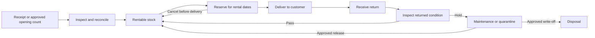

# Inventory lifecycle flow

The warehouse operator records each movement in Odoo and the applicable delivery, pickup or inspection evidence in Atlas. The pilot must prove that wrong-location stock, reserved items and quarantined units are excluded from availability. A cancellation releases the approved reservation. A late or damaged return stays outside eligible stock until the system owner confirms release.

[Inventory architecture](../architecture/inventory-and-availability.md) · [Inventory setup checklist](../implementation/02-inventory-setup.md)
